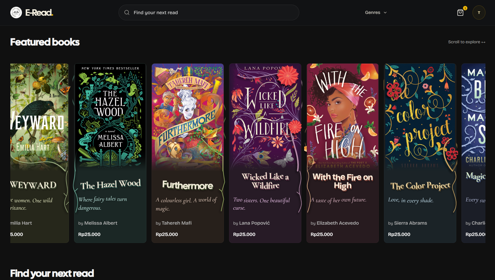
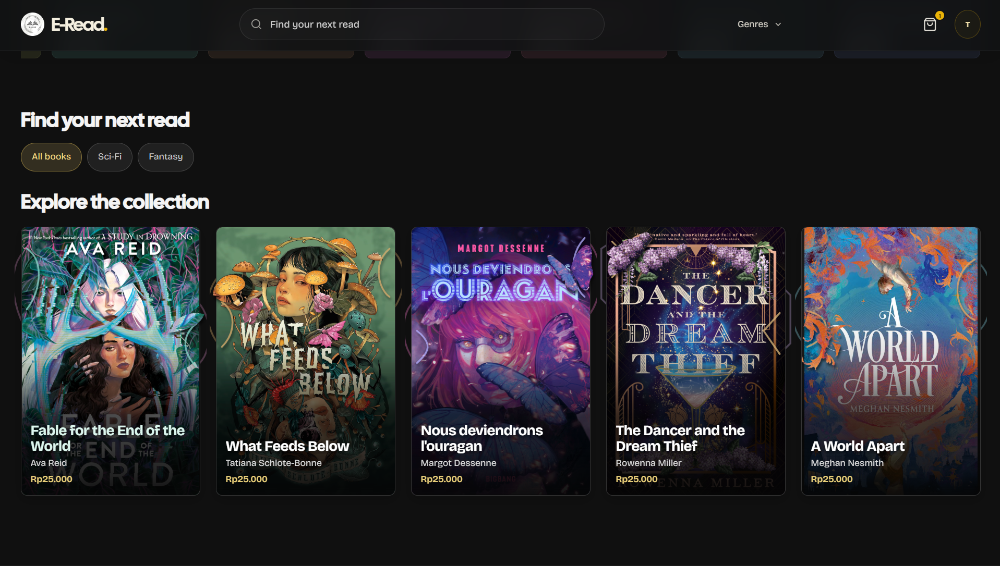
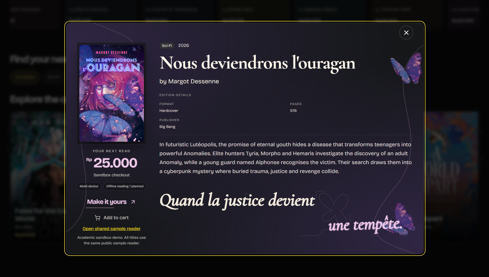
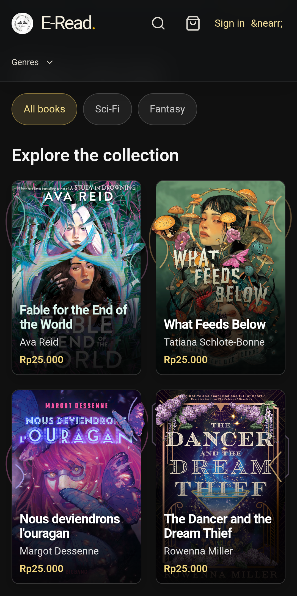
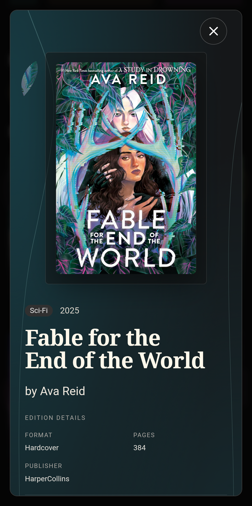
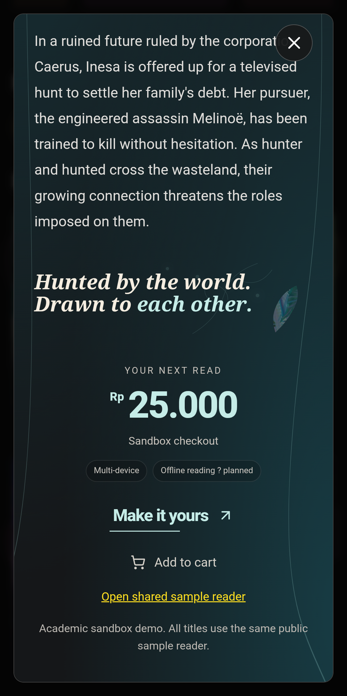

# E-Read

A cinematic bookstore demo built with Next.js, Express and MongoDB, featuring cover-inspired book details, personal libraries and Midtrans sandbox checkout.



**Academic portfolio project.** Payments use Midtrans's sandbox. All titles open the same original public sample reader; purchases do not deliver the commercial ebooks.

## Features

- **Book discovery:** searchable catalog, genre filters, continuously looping Featured shelf and responsive collection grid.
- **Editorial presentation:** local cover artwork, book-specific palettes, layered decorations and animated typography.
- **Personal accounts:** sign-in, profile updates, password changes, server-stored carts, purchased libraries and transaction history.
- **Sandbox checkout:** hosted Midtrans payment flow, verified server-side status, retry-safe library grants and pending-order recovery.
- **Administrator tools:** add, edit and reorder books with validation, edit-conflict checks and interrupted-save recovery.

## Screenshots

Captured by the project owner on desktop and phone. These show the populated local catalog; a fresh installation starts empty.





<details>
<summary>Mobile collection, book details and purchase controls</summary>

<p>
  
  
  
</p>

</details>

## Technology and structure

| Area | Stack / purpose |
| --- | --- |
| frontend/ | Next.js 15 App Router, React 19, Tailwind CSS 4, native CSS/WAAPI motion, dnd-kit, Lucide |
| backend/ | Express 4, MongoDB/Mongoose, JWT, bcrypt, Midtrans SDK |
| tests/ | Node assert regression checks and disposable-database integration suites |
| docs/ | Screenshots and operator guide |

The browser calls the Express API. MongoDB stores accounts, carts, catalog order, transactions and recovery records. Midtrans hosts sandbox checkout and sends notifications to the backend; verified gateway status determines payment and library updates.

## Local setup

### Prerequisites

- Node.js **24.x** and npm (see .nvmrc).
- MongoDB Community Server running locally, or a dedicated development database.
- A Midtrans sandbox account with its Server Key and Client Key.
- ngrok if testing notifications from Midtrans against your local backend.

Clone the repository:

```powershell
git clone https://github.com/justinmrco/e-read.git
cd e-read
```

### Backend

```powershell
cd backend
npm ci
Copy-Item .env.example .env
```

Copy environment examples only on a new installation; preserve existing values when updating. Configure backend/.env:

| Variable | Purpose |
| --- | --- |
| PORT | API port; normally 5000 |
| MONGODB_URI | Dedicated development MongoDB connection string |
| JWT_SECRET | Random secret of at least 32 bytes |
| FRONTEND_URL | Exact frontend origin, normally http://localhost:3001; no trailing slash |
| MIDTRANS_SERVER_KEY | Sandbox Server Key for outbound API calls |
| MIDTRANS_CLIENT_KEY | Sandbox Client Key from the same account |
| MIDTRANS_SIGNATURE_KEY | Incoming SHA512 signing secret; standard Snap uses the merchant Server Key here too |
| MIDTRANS_WEBHOOK_DEBUG | Keep false for routine operation |

Generate a JWT secret locally and save it only in the ignored environment file:

```powershell
node -e "console.log(require('node:crypto').randomBytes(32).toString('hex'))"
npm start
```

The API listens on port 5000 after MongoDB connects. Do not replace the outbound Server Key with a different webhook secret.

### Frontend

In a second terminal, from the repository root:

```powershell
cd frontend
npm ci
Copy-Item .env.example .env.local
npm run dev
```

Set NEXT_PUBLIC_API_URL in frontend/.env.local to http://localhost:5000. Open **http://localhost:3001**. Restart development after changing environment values; production frontend values require rebuilding.

For a production build, stop the frontend first, then run npm run build followed by npm start -- -p 3001 from frontend/. Never rebuild into a running production server's .next directory.

### Administrator and initial catalog

A new database has **no books or accounts**. The screenshots' catalog lives in the owner's local database and is not bundled as a database dump. No customer or transaction data is included.

1. Temporarily set ADMIN_USERNAME, ADMIN_EMAIL and ADMIN_PASSWORD in backend/.env. Use a unique admin email and a password of at least eight characters, at most 72 UTF-8 bytes.
2. From backend/, run npm run create-admin. This creates a new administrator; it does not promote an existing customer.
3. Remove the temporary administrator setup values from .env.
4. Open /admin on the frontend and sign in with that administrator account. Add books through the catalog editor.

Use artwork you have permission to use. Local cover paths are relative to frontend/public, for example /covers/your-cover.jpg. Add edition information only when verified. Catalog order determines the first seven Featured books; subsequent books enter the collection.

### Midtrans notifications

Keep the backend running and expose its port:

```powershell
ngrok http http://127.0.0.1:5000
```

Set the Midtrans **sandbox Payment Notification URL** to https://YOUR-NGROK-DOMAIN/api/midtrans/notification. Update it when the domain changes. Opening the URL in a browser does not test its POST handler.

See [operations and payment recovery](docs/OPERATIONS.md) for signing configuration, pending orders, administrator save recovery and reconciliation commands. A successful return page or HTTP 200 webhook acknowledgement alone does not prove payment.

### Testing on a phone

Connect both devices to the same trusted network. Set frontend NEXT_PUBLIC_API_URL to http://YOUR-PC-IP:5000 and backend FRONTEND_URL to http://YOUR-PC-IP:3001. Restart both servers and open that frontend address on both devices. If needed, start the frontend with npm run dev -- --hostname 0.0.0.0. Update both values when the PC's address changes. If the page opens but books fail to load, check the API URL and matching CORS origin.

## Verification

From frontend/:

```powershell
npm test
npm run lint
npm run build
npm audit
```

From backend/:

```powershell
npm test
npm run test:accounts
npm run test:admin
npm run test:payments
npm run test:archive
npm audit
```

Stop the frontend before building. Unit/regression checks use source modules with browser/API doubles; backend checks include native bcrypt and password middleware. Integration suites require local MongoDB, use uniquely named disposable test databases and simulate gateway calls. They do not use application customer records.

The owner reviewed desktop/mobile presentation and reported zero vulnerabilities in both packages at handoff. Audit results change over time: run the commands above for current results. Screenshots demonstrate presentation, not exhaustive acceptance or security verification.

For behavioral changes, verify sign-in/account switching, password revocation, cart isolation, sandbox settlement and failure recovery, admin authorization/conflicts, keyboard navigation, small-screen layouts and zoom.

## Scope and limitations

- Academic sandbox; no real payments, commercial ebook delivery, offline reading or refund implementation.
- All book reader links open the same original public sample. Published edition specifications describe the referenced books, not that sample.
- JWTs are stored in localStorage. Rate limiting is single-process; proxy trust is disabled. Production HTTPS, session design, trusted proxies and shared rate limiting need deployment-specific work.
- There is no automatic reconciliation worker. Receipt refreshes and trusted operator commands recover pending orders. Never manually unlock an unresolved payment based only on a timeout or failed lookup.
- Google Fonts requires network access; native fallback fonts remain available. Covers and decorative cutouts are local.
- Motion intentionally remains active regardless of OS reduced-motion preferences, following this project's current visual specification.

## License and credits

Original source code and documentation are available under the [ISC License](LICENSE). Third-party book covers, cover-derived decorations, the supplied logo and artwork visible in screenshots are excluded from that grant. Redistribution permissions for those assets have not been verified. See [asset and edition credits](ASSET-CREDITS.md).

Design conventions for future changes are documented in [AGENTS.md](AGENTS.md).
